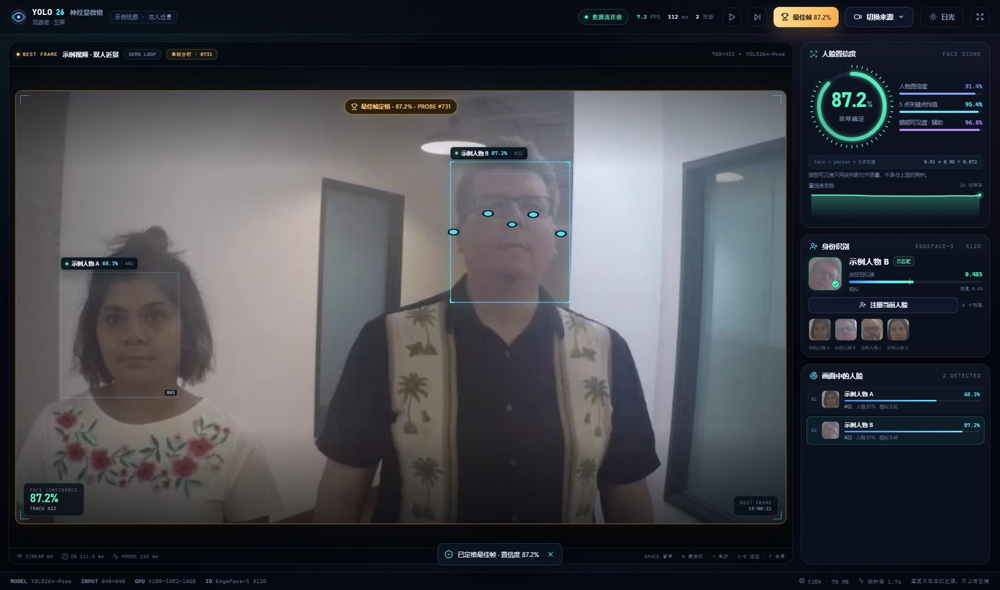
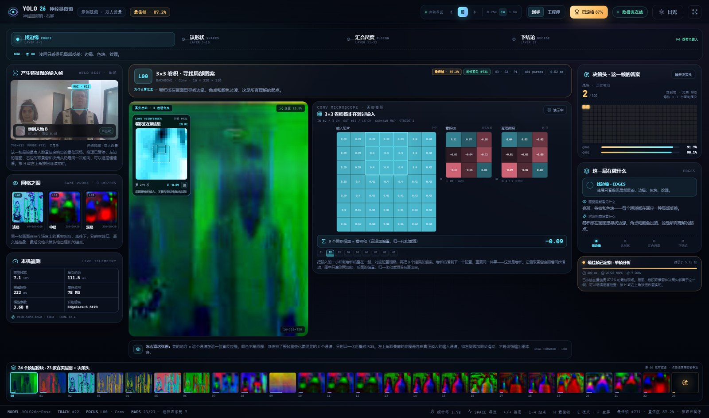

<div align="center">

# YOLO26 Neural Scope

**YOLO26 神经显微镜**

A dual-window, near-real-time YOLO26 interpretability lab for beginners.

[](LICENSE)
[](requirements.txt)
[](frontend/package.json)
[](THIRD_PARTY_NOTICES.md)

<p align="center">
  <a href="docs/screenshots/live-best-frame-night.jpg"></a>
  <a href="docs/screenshots/neural-conv-microscope-night.jpg"></a>
</p>

<sub>Left: live confidence and identity, frozen on the best frame. Right: the same probe frame's real feature maps, 3×3 convolution microscope and pose head. Demo footage: Intel IoT DevKit, CC BY 4.0.</sub>

</div>

> This is a teaching tool, not another detection demo. It opens up one real
> YOLO26 forward pass: confidence, 23 intermediate feature maps, a 3×3
> convolution microscope, and the pose head — all bound to the same frame.

The full teaching notes, classroom experiments and license details are in the
[Chinese README](README.md). This page is a quick English overview.

## What you get

- **Live window (`/live`)** — real-time face boxes, pose keypoints, face
  confidence, identity similarity, confidence history, best-frame hold.
- **Neural window (`/neural`)** — 23 real intermediate feature maps, seven
  convolution microscopes (layers `0, 1, 3, 5, 7, 17, 20`), and the
  YOLO26n-Pose head (`[1, 300, 57]`).
- **Same-forward binding** — a deep probe runs every 1.7 s; the input frame,
  feature maps, convolution viewfinder and head all carry the same `seq`.
- **Best-frame hold** — press `H` to freeze the highest-confidence probe of the
  currently tracked face in both windows, inspect layer by layer, then press
  `H` again to resume.
- **Real sources** — demo clip, uploaded video (up to 500 MB), webcam (opened
  on the backend machine), or an RTSP/HTTP stream.
- **Two themes** — night and a high-contrast daylight theme for projectors and
  classrooms.

## Quick start (Windows)

Requirements: Windows 10/11, Python 3.10, Node.js 20+, Edge or Chrome. An
NVIDIA GPU is optional; CPU works but is slower. Model weights and the demo
clip are bundled.

```powershell
git clone https://github.com/ADA-quart/yolo26-neural-scope.git
cd yolo26-neural-scope

conda create -n yolo26 python=3.10 -y
conda activate yolo26
pip install -r requirements.txt

.\start.bat
```

The launcher builds the frontend, starts the backend and opens two app
windows: `/live` on the left and `/neural` on the right. On a single monitor
the two windows are tiled side by side; with a second monitor each window gets
its own display.

To stop the hidden backend, double-click `stop.bat`; closing the app windows
does not stop it.

Manual mode (any OS):

```bash
cd frontend && npm ci && npm run build
cd ../backend
python -m uvicorn app:app --host 127.0.0.1 --port 8765
```

Open <http://127.0.0.1:8765/live> and
<http://127.0.0.1:8765/neural> in two browser windows.

## How it works

```text
video frame → 640×640 → YOLO26n-Pose
                          ├─ 23 top-level modules → real feature maps
                          ├─ 7 Conv2d modules     → 3×3 convolution microscope
                          └─ pose head [1,300,57] → 300 end-to-end query slots
                                                    (NMS-free) → boxes + 17 keypoints
                                                       → 5 facial keypoints → face ROI
                                                       → IoU tracker
                                                       → EdgeFace-S 512D → gallery match
```

Key ideas:

- The face box is **derived from the first five COCO pose keypoints** (nose,
  eyes, ears), because the detector is a person-pose model, not a dedicated
  face detector. Profile views and occlusions reduce confidence — which is
  itself a useful classroom observation.
- `face_conf = person_conf × mean(confidence of those 5 keypoints)`. Eye
  visibility is shown as an alignment-quality hint and is not part of the
  product. Identity similarity is a separate EdgeFace cosine score
  (threshold `0.45`).
- Feature maps are the top-3 variance channels of each tensor, min-max
  normalized and composited into RGB at 128×128. Colors are not the original
  image; brightness means channel activity.
- The convolution microscope uses one input channel and a 7×7 patch. The same
  3×3 kernel slides over nine positions (stride 2); the UI shows the nine
  multiply-accumulate sums. The cyan window in the viewfinder is the actual
  3×3 receptive field on the **input** channel, not the output map.
- The right window is a deep probe every 1.7 s, not a per-frame view. That is a
  deliberate engineering trade-off: 23 maps + 7 microscopes + JPEG encoding
  are expensive. The left window keeps running at video rate.

## Related work

Several excellent open-source projects cover adjacent ground, with different goals:

| Project | What it shows | How this project differs |
|---|---|---|
| [CNN Explainer](https://github.com/poloclub/cnn-explainer) | Layer-by-layer convolution, activations and classification for a small CNN in the browser | Uses a teaching TinyVGG and sample inputs; no YOLO26, live camera, detection head or identity |
| [Netron](https://github.com/lutzroeder/netron) | Static architecture graphs from model files | Does not run inference or show real activations |
| [RT-CNN-Vis](https://github.com/cyberneuron/RT-CNN-Vis) | Real-time activation maps for Keras models from a video stream | A 2019 Docker/Linux tool for generic Keras models; no YOLO26, pose head or teaching copy |
| [darknet-vis](https://github.com/xueeinstein/darknet-vis) | YOLO objectness / class grids at prediction time | YOLOv2-era C implementation; static images, not per-layer maps |
| [YOLOv5-Grad-CAM](https://github.com/pooya-mohammadi/yolov5-gradcam) | Grad-CAM heatmaps for selected YOLOv5 layers | Offline notebooks; heatmaps rather than full layer maps and multiply-accumulate steps |
| [YOLO Architecture Visualizer](https://github.com/zhanghuiwan/yolo-arch-visualizer) | Interactive YAML architecture, modules and shapes for YOLO26 and earlier models | Architecture only; no weights, inference or activations |
| [Vision Studio](https://github.com/misaka-ning/vision-studio) | Local YOLO inference plus model graph, layer tree and parameter table | Qt desktop app; structure visualization is not activation visualization |
| [YOLO Vision Studio](https://github.com/aparsoft/yolo-streamlit-detection-tracking) | YOLO26 detection / segmentation / pose / tracking UI | Shows final results only, not the internals |

Stars and features change; this table describes public capabilities at the time of writing.

The differentiator is the combination: **one real forward pass** feeding 23 intermediate feature maps, seven convolution multiply-accumulate views and the pose head; a face confidence formula derived from YOLO26 pose keypoints; and a dual-window, pause/step/best-frame workflow for teaching. If you only need model structure, Netron or YOLO Architecture Visualizer is a better fit; if you only need detection or tracking, YOLO Vision Studio is more direct. This project answers a different question: **what does one forward pass see at each layer, and how does that become the final answer?**

## License

**Code: AGPL-3.0.** The project uses and redistributes Ultralytics YOLO26
(AGPL-3.0). If you deploy a modified version as a network service, AGPL §13
requires you to offer the corresponding source to its users.

**Exceptions bundled with the demo:**

| Component | License |
|---|---|
| `weights/yolo26n-pose.pt` (Ultralytics) | AGPL-3.0 |
| `weights/edgeface_s_gamma_05.onnx` (Idiap EdgeFace-S) | **CC BY-NC-SA 4.0 — non-commercial only** |
| `assets/` demo video and face crops (Intel IoT DevKit) | CC BY 4.0 |

Commercial use requires an Ultralytics commercial license and replacement of
(or permission for) the EdgeFace weights. See
[`THIRD_PARTY_NOTICES.md`](THIRD_PARTY_NOTICES.md) and
[`NOTICE`](NOTICE) for the full map. This is not legal advice.

## Links

- Personal repository: <https://github.com/ADA-quart/yolo26-neural-scope>
- CDUT-AI-Club mirror: <https://github.com/CDUT-AI-Club/yolo26-neural-scope>
- Ultralytics YOLO26: <https://docs.ultralytics.com/models/yolo26>
- EdgeFace: <https://github.com/otroshi/edgeface>
- Demo footage: <https://github.com/intel-iot-devkit/sample-videos>

---

<sub>Built as a teaching project for the CDUT AI Club. Use it to explain what a
network sees, not to surveil people.</sub>
