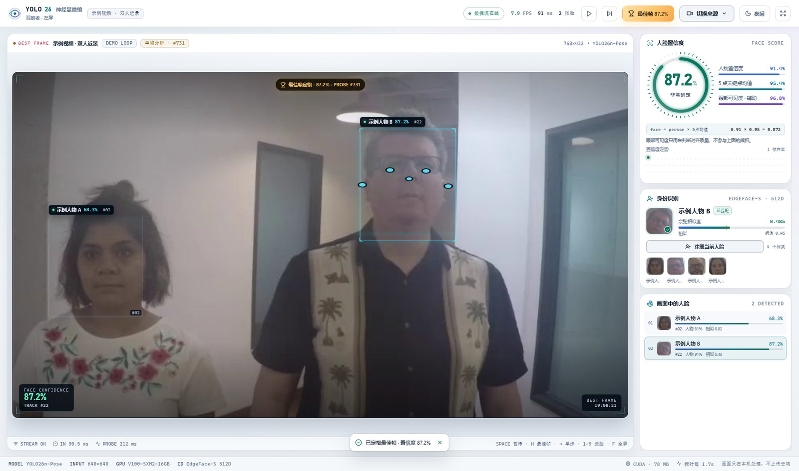
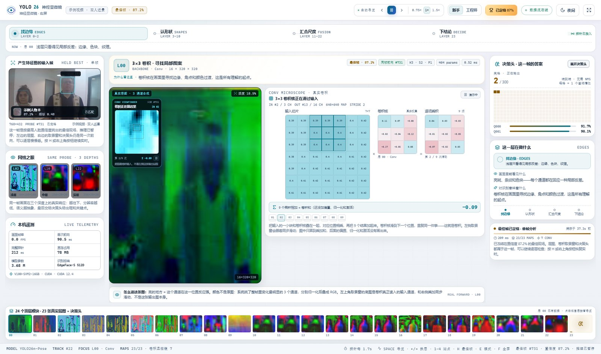

<div align="center">

# YOLO26 神经显微镜

**YOLO26 Neural Scope**

把 YOLO26 的一次真实前向拆开：左屏看它有多确定，右屏看它到底看到了什么。

[](LICENSE)
[](requirements.txt)
[](frontend/package.json)
[](THIRD_PARTY_NOTICES.md)

<p align="center">
  <a href="docs/screenshots/live-best-frame-night.jpg"></a>
  <a href="docs/screenshots/neural-conv-microscope-night.jpg"></a>
</p>

<sub>左：观察者，最佳帧 87.2%；右：神经显微镜，同一探针帧的 L00 卷积取景窗与 3×3 乘加。演示视频来自 Intel IoT DevKit（CC BY 4.0）。</sub>

</div>

> 这是一个面向初学者的 **YOLO26 可解释性教学项目**，不是再跑一个“画框 + 显示类别”的检测 demo。
> 它把置信度、23 张真实中间特征图、卷积乘加、Pose 决策头放回**同一次前向**里，并且可以暂停、定格、逐层慢慢看。

---

## 目录

- [这是什么](#这是什么)
- [30 秒跑起来](#30-秒跑起来)
- [两个窗口各自在看什么](#两个窗口各自在看什么)
- [它和普通 YOLO 可视化的区别](#它和普通-yolo-可视化的区别)
- [背后的原理（教育重点）](#背后的原理教育重点)
- [课堂实验](#课堂实验)
- [安装与运行](#安装与运行)
- [快捷键](#快捷键)
- [项目结构](#项目结构)
- [性能与硬件](#性能与硬件)
- [已知限制与边界](#已知限制与边界)
- [相关项目与定位](#相关项目与定位)
- [许可证（重要）](#许可证重要)
- [致谢与参考](#致谢与参考)

---

## 这是什么

YOLO26 神经显微镜是一个**双窗口、接近实时**的计算机视觉教学工具：

- **左屏「观察者」**：播放视频 / 摄像头 / 视频流，实时显示人脸框、姿态关键点、人脸置信度、身份相似度与置信度历史。
- **右屏「神经显微镜」**：显示同一次前向里的 23 张真实中间层特征图、7 个卷积层的 3×3 卷积显微镜、以及 Pose 决策头的候选与最终答案。
- **两个窗口同步**：右屏探针每 1.7 秒做一次“深挖”；按 `H` 可以把当前跟踪对象的最高置信帧定格，两个窗口一起冻结在同一帧，逐层分析完再按 `H` 回到实时。

项目基于 **YOLO26n-Pose**（3.68M 参数，640×640 输入）和 **EdgeFace-S**（512 维人脸嵌入）。它最初为成都理工大学人工智能协会（CDUT-AI-Club）的 CV 入门分享而做，重点不是“模型有多强”，而是**让刚接触的人能亲眼看到网络内部在发生什么**。

---

## 30 秒跑起来

### Windows 一键启动

前提：Windows 10/11、Python 3.10、Node.js 20+、Edge 或 Chrome；有 NVIDIA GPU 更好，没有也能用 CPU（会慢一些）。

```powershell
git clone https://github.com/ADA-quart/yolo26-neural-scope.git
cd yolo26-neural-scope

conda create -n yolo26 python=3.10 -y
conda activate yolo26
pip install -r requirements.txt

.\start.bat
```

`start.bat` 会自动构建前端、启动后端，并打开两个独立的应用窗口：左屏 `/live`，右屏 `/neural`。首次加载模型大约需要 10–40 秒。

> 权重和演示视频已经随仓库提供，不需要额外下载。只检测到一块屏幕时，两个窗口会全尺寸叠放，用 `Alt+Tab` 切换；接上外接显示器后会分屏。

### 手动启动（Windows / macOS / Linux）

```bash
# 终端 1：构建前端
cd frontend
npm ci
npm run build

# 终端 2：启动后端（工作目录必须是 backend）
cd ../backend
python -m uvicorn app:app --host 127.0.0.1 --port 8765
```

然后打开两个浏览器窗口：

- 左屏：<http://127.0.0.1:8765/live>
- 右屏：<http://127.0.0.1:8765/neural>
- 启动器页：<http://127.0.0.1:8765/>

---

## 两个窗口各自在看什么

| 左屏「观察者」 | 右屏「神经显微镜」 |
|---|---|
| 实时视频画面与人脸跟踪框 | 产生特征图的那一帧输入画面 |
| 人脸置信度仪表 + 置信度分解 | 23 张中间层特征图（3 通道合成） |
| 身份识别：姓名、相似度、已知/未知 | 7 个卷积层的 3×3 卷积显微镜 |
| 画面中所有人脸的列表与切换 | 决策头 300 个查询槽位与最终框/关键点 |
| 5 点关键点、眼部可见度、历史曲线 | 4 个教学站点：找边缘 / 认形状 / 汇合尺度 / 下结论 |
| 最佳帧按钮、暂停、单步 | 最佳帧单帧分析、逐层导航 |

左屏的实时画面**不等探针**，会持续刷新；右屏只显示最近一次探针的那一帧。两者通过 WebSocket 同步选中的人脸、暂停/定格状态和视频源。

<p align="center">
  
  
</p>

<sub>同一套界面的日光高对比模式，适合投影、教室和户外展示。</sub>

---

## 它和普通 YOLO 可视化的区别

1. **同一帧，而不是拼图。** 右屏的输入帧、特征图、卷积取景窗、决策头都来自同一次真实前向，探针消息里带同一个 `seq`；不会出现“旧特征图套新画面”。
2. **真实 hook，而不是示意图。** 23 张层图由 PyTorch forward hook 从模型顶层模块输出中抓取；不是预先画好的概念图。
3. **卷积能对上账。** 取景窗显示的是卷积**真正读入的输入通道**，青色 3×3 窗口与右侧乘加表同步滑动，能对照“输出像素 = 9 个乘积之和”。
4. **可以停下来。** 空格暂停、方向键单步、`H` 定格最佳帧；右屏的层图、卷积显微镜和决策头会一起冻结，适合课堂逐层讲解。
5. **置信度可拆解。** 不是只给一个 87%，而是拆成“人物置信度 × 5 个面部关键点均值”，并明确眼部可见度只作辅助，不参与乘积。

---

## 背后的原理（教育重点）

### 1. 一次前向的路线

```text
视频帧
  → letterbox 到 640×640
  → YOLO26n-Pose 的 backbone / neck / head
       ├─ 24 个顶层模块中的 23 个 → 特征图快照（右屏层图）
       ├─ 7 个含 Conv2d 的模块     → 卷积显微镜（输入通道 + 3×3 窗口）
       └─ Pose head [1, 300, 57]   → 端到端查询槽位（无需 NMS）
                                        → 置信度筛选 → 人体框 + 17 组关键点
  → 前 5 个面部关键点（鼻、双眼、双耳）→ 人脸框
  → IoU 跟踪器给每个人一个稳定 ID
  → EdgeFace-S 512D 嵌入 → 与本地人脸画廊做余弦相似度比对
```

几个容易混淆的点：

- 本项目用的是 **YOLO26n-Pose（人体姿态模型）**，不是人脸检测专用模型。人脸框是从前 5 个姿态关键点推导出来的，所以侧脸、遮挡、关键点置信度低时，人脸置信度也会下降——这正好是课堂里可以观察的现象。
- 人脸框只是“看哪里”的 ROI，**不参与** YOLO 的特征图计算；真正跑网络的是整张 640×640 的画面。
- 身份识别是另一个模型（EdgeFace-S）在做，和人脸置信度不是一回事。

### 2. 人脸置信度是怎么算的

左屏显示的 `face_conf` 是：

```text
face_conf = person_conf × mean(kp_conf[0:5])
```

- `person_conf`：Pose 头对该人体的置信度。
- `kp_conf[0:5]`：COCO 17 个关键点里的前 5 个——鼻、左眼、右眼、左耳、右耳——的置信度均值。
- **眼部可见度** = 左右眼置信度的较小值，只用来判断人脸对齐质量，**不参与**上面的乘积。
- **身份相似度**是 EdgeFace 512D 嵌入的余弦相似度，默认匹配阈值 `0.45`，与 `face_conf` 相互独立。

对应代码：`backend/identity.py` 的 `face_box_from_pose()` 与 `backend/engine.py` 的 `_parse()`。

这解释了为什么一个人“姿态很像人”但“脸看不清”时，分数会掉：`person_conf` 可能仍然高，但 5 个面部关键点均值会先掉下来。

### 3. 23 张特征图是怎么来的

1. 对模型 24 个顶层模块注册 forward hook。
2. 探针时只做一次完整前向，抓取其中 23 个模块的输出张量（第 24 个是决策头，单独处理）。
3. 每个张量在整张图上挑**方差最大的 3 个通道**，各自做 min-max 归一化，再叠成 RGB，缩到 128×128 的 JPEG。
4. 右屏显示的是“哪 3 个通道、平均亮度多少”，不是原始 64/128 通道的全量张量。

所以：

- **颜色不是原图颜色**，而是通道响应的可视化映射；亮的地方表示该通道在这个位置反应强。
- 层号越小，分辨率越高、越像边缘和纹理；层号越大，分辨率越低、语义越抽象。
- 右下角的 `活度` 是归一化图像的平均亮度，用来快速判断“这一层整体兴不兴奋”，不是模型指标。

### 4. 卷积显微镜：把一次乘加摊开

在 YOLO26n-Pose 上，有 7 个顶层模块包含 `Conv2d`（层号 `0, 1, 3, 5, 7, 17, 20`），它们会额外生成卷积显微镜数据：

- 根据当前选中人脸的 ROI，挑一个输入通道和一块 **7×7** 的输入 patch。
- 用同一组 **3×3** 权重，在 patch 上按 **stride 2** 滑动 **9 个位置**（右侧的 01–09）。
- 每个位置做 9 次乘加，得到一个输出值；右侧表格会把 3×3 输入块、3×3 卷积核、逐项乘积和结果画出来。
- 界面只演示“乘加和”；真实模块后面还有偏置、BatchNorm 和 SiLU 激活，动画里没有画出来。

左屏特征图左上角的 **CONV VIEWFINDER** 是同一件事的另一半：

- 底图是卷积**真正读入的输入通道**，不是这张输出层图本身。
- 青色方块是 3×3 窗口；它和右侧乘加的 01–09 步同步移动。
- 这能直观回答一个问题：**输出特征图上的一个点，到底看了输入的哪一块？**

### 5. 决策头：300 个查询槽位如何变成最终答案

Pose 头输出形状是 `[1, 300, 57]`，YOLO26 使用的是**端到端、无需 NMS** 的查询式输出：

```text
57 = 4 个框坐标 + 1 个人体置信度 + 1 个类别 + 17×3 个关键点 (x, y, conf)
```

300 个查询槽位同时给出答案；训练时的一对一匹配让每个目标只落到一个槽位，因此推理时不需要再跑 NMS。后处理流程：

1. 按 `person_conf ≥ 0.25` 过滤。
2. 按分数排序，取前若干个有效槽位。
3. 取前 5 个面部关键点推导人脸框，再交给跟踪器和身份模型。

右屏的“决策头在这一帧的答案”会显示有效槽位数 / 300、每个槽位的分数、最终框和关键点。它展示的是**这一次前向的真实输出**，不是另一套检测结果。

### 6. 为什么右屏不是逐帧直播

一次完整探针要抓 23 张层图、7 组卷积显微镜、决策头，并做 JPEG 编码；如果每帧都做，实时 FPS 会明显下降。所以设计成：

- 左屏按视频帧率持续跑检测；
- 右屏每 **1.7 秒**做一次完整探针；
- 探针消息带 `seq`，右屏的输入帧、层图、显微镜、决策头都绑定到同一个 `seq`；
- 左屏 HUD 和右屏 `PROBE #` 显示的是同一个前向序号，方便核对“是不是同一帧”。

这是一个真实的工程取舍：**可解释性是有成本的**。课堂上可以借这一点讲“为什么调试工具通常比推理本身慢”。

### 7. 最佳帧定格：把“最好的一张”留下来

- 后端持续记录当前选中人脸的最高 `face_conf` 探针快照。
- 按 `H`（或点顶栏奖杯按钮）发送 `hold`：推理暂停，前后端都切换到这份快照，两个窗口同步进入单帧分析。
- 再按 `H` 发送 `release`：回到实时；`→` 单步或切换视频源也会解除定格。
- 最佳值绑定“当前选中的人脸”，这样左屏 HUD、右屏 ROI、卷积取景窗和身份面板始终指同一个人；切换人脸后，最佳值会按新目标重新累计。

适合的用法：等一个正面、清晰、分数高的瞬间按 `H`，然后逐层讲完整个前向，再回到实时。

---

## 课堂实验

1. **拆置信度**：让同一个人正脸、侧脸、用手遮住一只眼睛，观察 `person_conf`、`kp_conf`、`eye_conf` 三者谁先掉，验证 `face_conf = person × 5 点均值`。
2. **浅层 vs 深层**：暂停后切换 L00 / L10 / L22，比较分辨率、纹理和语义的变化；问一句“为什么越深越不像原图？”
3. **追一个卷积窗口**：选一个卷积层，按 `→` 逐步移动，观察取景窗的青色 3×3 窗口和右侧乘加表如何同步；再对照输入通道与输出层图。
4. **定格最佳帧**：按 `H` 定格 87% 的那一帧，切到决策头看 300 个查询槽位和最终结果，再逐层检查；最后按 `H` 回到实时。
5. **注册一张脸**：在左屏“身份识别”面板注册一个同意被录入的同学，观察相似度、`已知/未知` 状态和阈值 0.45 的关系。
6. **多人场景**：切换到“三人街景”，用数字键 `1–9` 切换跟踪对象，观察 ROI、卷积取景窗和身份面板是否一起切换。

> 课堂提示：右屏的 `E` 键可以在“新手 / 工程师”模式间切换；工程师模式会多显示 shape、kernel、stride、padding、groups、params。

---

## 安装与运行

### 环境要求

| 项目 | 要求 |
|---|---|
| 操作系统 | Windows 10/11（一键启动器）；macOS/Linux 可手动运行 |
| Python | 3.10（本机验证 3.10.20） |
| Node.js | 20+（构建 Vite 前端） |
| 浏览器 | Edge 或 Chrome |
| GPU | 可选；本机验证 Tesla V100 16GB / CUDA 12.4 |
| Python 依赖 | 见 `requirements.txt`（已固定验证版本） |

### 安装依赖

```bash
conda create -n yolo26 python=3.10 -y
conda activate yolo26
pip install -r requirements.txt
```

`requirements.txt` 里的 `torch==2.6.0+cu124` / `torchvision==0.21.0+cu124` 是本机验证的 CUDA 12.4 组合。如果你用 CPU 或别的 CUDA 版本，先按 <https://pytorch.org/get-started/locally/> 安装匹配的 torch/torchvision，再安装其余依赖。

### 启动

- **Windows 一键**：`.\start.bat`（会检测前端构建、启动后端、打开双窗）。
- **手动**：先 `cd frontend && npm ci && npm run build`，再 `cd backend && python -m uvicorn app:app --host 127.0.0.1 --port 8765`，最后打开 `/live` 与 `/neural`。

### 数据源

左屏右上角“切换来源”支持：

- **示例视频**：双人近景、三人街景（来自 `assets/sample_faces.mp4`）。
- **上传本地视频**：mp4 / webm / mov / avi / mkv / m4v，最大 500MB。
- **打开摄像头**：由后端所在机器用 OpenCV 打开摄像头（默认索引 0）；没有摄像头时请用示例视频。
- **视频流地址**：RTSP / HTTP 视频流 URL。

所有处理都在本机完成，不上传云端。上传的视频和人脸画廊写入 `state/`，该目录已被 `.gitignore` 排除。

---

## 快捷键

### 左屏「观察者」

| 按键 | 作用 |
|---|---|
| `Space` | 暂停 / 继续 |
| `→` | 单步前进一帧（暂停时） |
| `H` | 定格 / 解除最佳帧 |
| `1–9` | 选择第 N 张人脸 |
| `F` | 全屏 |

### 右屏「神经显微镜」

| 按键 | 作用 |
|---|---|
| `Space` | 暂停 / 继续导览 |
| `←` / `→` | 切换上一 / 下一层 |
| `1–4` | 跳到四个教学站点（边缘 / 形状 / 尺度 / 结论） |
| `H` | 定格 / 解除最佳帧 |
| `E` | 新手 / 工程师模式 |
| `F` | 全屏 |

---

## 项目结构

```text
yolo26-neural-scope/
├─ backend/
│  ├─ app.py            FastAPI：REST、WebSocket、静态前端
│  ├─ engine.py         单推理线程：视频源、检测、跟踪、最佳帧
│  ├─ probes.py         forward hook：23 张层图、决策头、7 组卷积显微镜
│  ├─ identity.py       EdgeFace 512D 嵌入、人脸对齐、本地画廊
│  └─ tracker.py        IoU 人脸跟踪器
├─ frontend/
│  ├─ src/screens/      LiveScreen（左屏）、NeuralScreen（右屏）、Launcher
│  ├─ src/components/   神经显微镜、卷积乘加、层带、HUD 等
│  └─ src/styles/       night / daylight 双主题
├─ assets/              演示视频与示例人脸（CC BY 4.0，见 assets/README.md）
├─ weights/             YOLO26n-Pose + EdgeFace-S ONNX（各自许可，见 weights/README.md）
├─ docs/screenshots/    README 截图
├─ run.ps1 / start.bat  Windows 双窗启动器
├─ requirements.txt     Python 依赖（固定版本）
├─ LICENSE              AGPL-3.0
├─ NOTICE               版权与第三方权重提示
└─ THIRD_PARTY_NOTICES.md  完整许可证映射
```

---

## 性能与硬件

本机验证环境：Windows 11、Tesla V100 16GB、CUDA 12.4、PyTorch 2.6.0+cu124、ultralytics 8.4.48。

- 实时检测循环约 **7–9 FPS**（640×640，含跟踪与身份嵌入）。
- 一次完整探针约 **200 ms**，每 **1.7 s** 一次。
- 右屏层图 128×128、卷积取景窗 168×168，均用 JPEG 传输，避免 WebSocket 被大图拖慢。
- 显存占用很低；瓶颈主要在探针的多次张量操作和 JPEG 编码，而不是模型本身。
- CPU 可以跑，但推理会明显变慢；探针节奏不变，实时画面可能出现等待。

这些数字是单机实测，不是基准测试。换显卡、换视频分辨率、换浏览器都会变化。

---

## 已知限制与边界

- **不是人脸识别产品。** 没有活体检测、防伪、质量评估或访问控制能力；阈值 0.45 只是一个演示默认值，未做业务校准。
- **不是专用人脸检测器。** 人脸框由人体姿态关键点推导，侧脸、遮挡、远距离会直接影响框和置信度。
- **可视化是降维后的。** 层图只取 3 个通道、缩到 128×128；卷积只展示一个输入通道的一块 patch；决策头只展示部分候选。它们适合教学，不等价于完整张量。
- **右屏有探针延迟。** 右屏最多比左屏晚 1.7 秒；定格后才是严格同一帧的静态分析。
- **双窗启动器只针对 Windows。** macOS/Linux 用手动命令 + 两个浏览器窗口。
- **演示素材有肖像。** 请不要把示例视频用于监控、身份画像或其他侵犯隐私的场景；注册真实人脸前请获得本人同意。
- **许可证有边界。** 代码是 AGPL-3.0；内置 EdgeFace 权重是非商业的 CC BY-NC-SA 4.0；YOLO26 权重是 AGPL-3.0。详见下一节。

---

## 相关项目与定位

这个方向已经有不少优秀的开源工作，但侧重点不同：

| 项目 | 适合看什么 | 与本项目的差异 |
|---|---|---|
| [CNN Explainer](https://github.com/poloclub/cnn-explainer) | 在浏览器里逐层观察一个小型 CNN 的卷积、激活和分类 | 使用教学用 TinyVGG 和示例输入，不接 YOLO26 / 摄像头，也没有检测头和身份识别 |
| [Netron](https://github.com/lutzroeder/netron) | 打开模型文件，查看静态计算图和层结构 | 不运行推理，不显示真实激活值 |
| [RT-CNN-Vis](https://github.com/cyberneuron/RT-CNN-Vis) | 从视频流实时查看 Keras 模型各层激活图 | 2019 年的 Docker/Linux 工具，面向通用 Keras 模型；没有 YOLO26、Pose 头或教学文案 |
| [darknet-vis](https://github.com/xueeinstein/darknet-vis) | 查看 YOLO 预测阶段的 objectness / 类别网格 | YOLOv2 时代实现，输出静态图片，不是逐层特征图 |
| [YOLOv5-Grad-CAM](https://github.com/pooya-mohammadi/yolov5-gradcam) | 用 Grad-CAM 看 YOLOv5 某些层关注哪里 | 离线 Notebook，得到的是热力图，不是整层特征图和卷积乘加过程 |
| [YOLO Architecture Visualizer](https://github.com/zhanghuiwan/yolo-arch-visualizer) | 交互查看 YOLO26 等模型的 YAML 架构、模块和 shape | 只画架构，不加载权重、不跑真实前向 |
| [Vision Studio](https://github.com/misaka-ning/vision-studio) | 本地 YOLO 推理，加模型结构图、层级树和参数表 | Qt 桌面应用；结构可视化不等于中间层激活可视化 |
| [YOLO Vision Studio](https://github.com/aparsoft/yolo-streamlit-detection-tracking) | YOLO26 检测 / 分割 / Pose / 跟踪的推理界面 | 只展示最终检测结果，不拆开网络内部 |

（星标和功能会变化，以上只描述写作时的公开能力。）

本项目的差异不在“又一个检测 UI”，而在组合：

- **同一次真实前向**里同时取 23 张中间层特征图、7 组卷积乘加过程和 Pose 头候选；
- 用 **YOLO26n-Pose**，把“人物置信度 × 面部关键点置信度”拆成可核对的人脸置信度，并接上身份比对；
- 以 **双窗口 + 暂停/单步/最佳帧定格** 组织课堂讲解，而不是一次性截图或 Notebook；
- UI 全部在浏览器里运行，Windows 可一键启动。

如果你主要想看模型结构，Netron 或 YOLO Architecture Visualizer 更合适；如果只想做检测/跟踪，YOLO Vision Studio 更直接。神经显微镜解决的是另一个问题：**一次前向到底在每一层看到了什么，最后又是怎么变成答案的。**

---

## 许可证（重要）

| 内容 | 许可证 | 说明 |
|---|---|---|
| 本仓库源代码 | **AGPL-3.0** | 见 [`LICENSE`](LICENSE) |
| `weights/yolo26n-pose.pt` + Ultralytics 运行时 | **AGPL-3.0** | 商用/闭源需 Ultralytics 企业授权 |
| `weights/edgeface_s_gamma_05.onnx` | **CC BY-NC-SA 4.0** | Idiap EdgeFace-S 预训练权重，**仅限非商业** |
| `assets/` 演示视频与人脸裁剪 | **CC BY 4.0** | Intel IoT DevKit sample-videos，需保留署名 |

### 为什么代码是 AGPL-3.0，而不是 MIT

本项目在运行时依赖 Ultralytics，并随仓库分发 YOLO26 权重。Ultralytics 的 YOLO26 采用 AGPL-3.0；把项目标成 MIT 会掩盖这个事实。因此源代码整体按 **AGPL-3.0** 发布：

- 可以学习、修改、分发；
- 分发修改版时要继续开源，并提供对应源代码；
- **AGPL 第 13 条（网络使用）**：如果你把修改版作为网络服务提供给别人用，使用者应能获得对应源代码；
- 不提供任何担保。

这不是法律意见，约束条款以 [`LICENSE`](LICENSE) 为准。

### EdgeFace 权重为什么单独标注

EdgeFace 的**推理代码**是 BSD-3-Clause，但**预训练权重**的官方模型卡标注为 **CC BY-NC-SA 4.0**：

- **NC**：不得用于商业优势或金钱报酬；
- **SA**：对权重的改编（例如格式转换）需保持同一许可；
- 需要商用请替换为可商用的人脸嵌入模型，或向 Idiap 取得单独授权。

仓库里的 ONNX 是 EdgeFace-S（γ=0.5）权重的格式转换，随教学演示提供，不代表 Idiap 对本项目背书。

### 商用路径

1. 向 Ultralytics 取得商业授权，或换用许可证允许商用的检测器；
2. 替换 EdgeFace 权重，或取得 Idiap 的商业许可；
3. 保留 `NOTICE`、`THIRD_PARTY_NOTICES.md`、`assets/README.md` 与 CC BY 署名；
4. 如果以网络服务形式部署修改版，按 AGPL §13 提供源代码。

完整的依赖许可证清单、上游链接和再分发注意事项见 [`THIRD_PARTY_NOTICES.md`](THIRD_PARTY_NOTICES.md)。

---

## 致谢与参考

感谢这些开源工作，让这个教学项目成为可能：

- [Ultralytics YOLO26](https://docs.ultralytics.com/models/yolo26) — 检测与姿态模型、权重和推理框架（AGPL-3.0）。
- [Idiap EdgeFace](https://github.com/otroshi/edgeface) — 轻量人脸识别模型（代码 BSD-3-Clause；权重 CC BY-NC-SA 4.0）。
  - *EdgeFace: Efficient Face Recognition Model for Edge Devices*，<https://arxiv.org/abs/2307.01838>
- [Intel IoT DevKit sample-videos](https://github.com/intel-iot-devkit/sample-videos) — 演示视频（CC BY 4.0）。
- PyTorch、ONNX Runtime、OpenCV、NumPy、FastAPI、Uvicorn、Pydantic、React、Vite、TypeScript、framer-motion、lucide-react。
- 成都理工大学人工智能协会（CDUT-AI-Club）的同学们提供的课堂反馈。

### 仓库

- 个人主仓库：<https://github.com/ADA-quart/yolo26-neural-scope>
- 协会镜像：<https://github.com/CDUT-AI-Club/yolo26-neural-scope>

如果这个项目对你有帮助，欢迎 star；发现问题请开 issue。提交 PR 时请不要把 `state/`、真实人脸数据或临时截图带进仓库。

---

<div align="center">
<sub>用一次真实前向，讲清楚 YOLO26 看见了什么。</sub>
</div>
